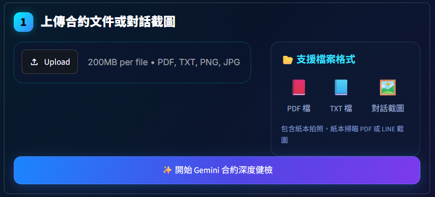
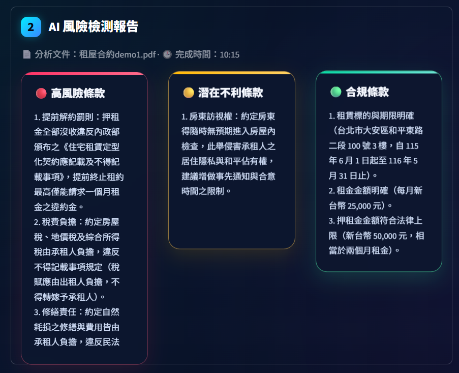
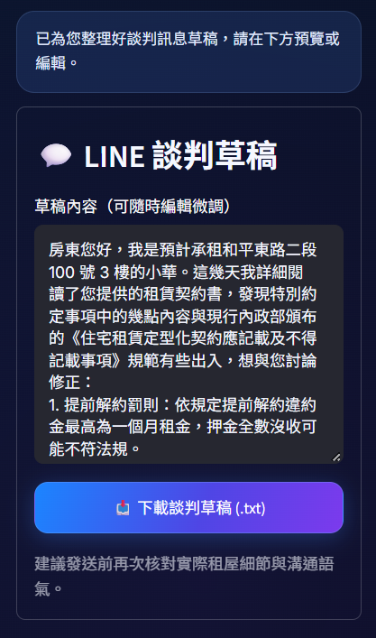
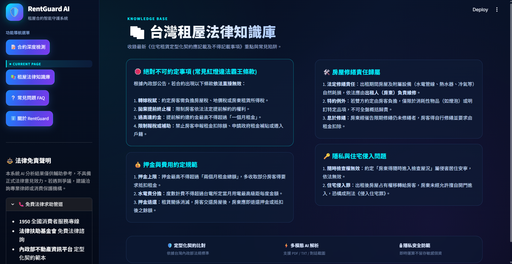

## 🧪 功能測試與系統驗證紀錄

為確保 **RentGuard AI** 在不同文件格式、法律條款情境與異常輸入下皆能穩定運作，團隊針對以下五項核心情境進行實機測試與驗證：

| 測試編號 | 測試情境與格式 | 輸入測試內容說明 | 預期系統表現 | 實際測試結果 | 狀態 |
| :--- | :--- | :--- | :--- | :--- | :---: |
| **T-01** | **PDF 租賃契約解析** (`demo_contract.pdf`) | 包含提前解約沒收全額押金、稅費轉嫁房客、無預警看屋等霸王條款，以及正常租金約定。 | 順利萃取 PDF 文字，紅燈標示違法條款、綠燈標示合規條款，並生成對應談判草稿。 | 成功讀取文字並精準歸類於紅、黃、綠三色卡片，LINE 草稿針對違規點提出具體法理修正建議。 | ✅ 通過 |
| **T-02** | **TXT 純文字條款檢測** (`clause_test.txt`) | 貼上自訂之房屋修繕責任轉嫁條款（自然耗損全歸承租人負責）。 | 正確讀取 UTF-8 文字，將概括轉嫁修繕責任判讀為高風險或不利條款。 | 順利解析並於風險卡片指出民法修繕義務原則，草稿語氣禮貌且具備協商重點。 | ✅ 通過 |
| **T-03** | **對話截圖多模態辨識** (`chat_screenshot.png`) | 房東於 LINE 訊息中表示「若要申請租金補貼或報稅，每月租金需調漲 2,000 元」。 | 透過多模態影像解析讀取截圖文字，識別違反定型化契約不得記載事項。 | 成功辨識截圖對話內容，於紅燈卡片提示禁止限制報稅／補貼規範，並產出對應溝通回覆。 | ✅ 通過 |
| **T-04** | **非租屋文件防呆守衛** (`unrelated_doc.pdf`) | 上傳與租屋無關之一般程式碼文件或課程筆記。 | 觸發 Guardrail 守衛機制，阻擋分析並提示上傳正確租屋文件，避免 AI 產生幻覺。 | 系統成功攔截並顯示「偵測到內容可能與租屋合約或房東對話無關」錯誤提示，未輸出誤導報告。 | ✅ 通過 |
| **T-05** | **UI 互動與多頁導航** (全系統介面操作) | 切換側邊欄四個分頁、編輯 LINE 草稿並下載 `.txt`、檢視 1950／法扶求助資訊。 | 各頁面獨立切換不重疊，草稿可即時編輯並匯出純文字檔。 | 側邊欄高亮指示正常、頁面無重疊現象，草稿下載與求助資源展開功能皆正常運作。 | ✅ 通過 |
---
## 🔒 程式碼安全與隱私檢查紀錄（`app.py`）

為確保開源倉庫與使用者上傳文件之安全性，已針對 `app.py` 進行逐行安全與隱私檢核，確認無硬編碼金鑰、無本機絕對路徑，且不會於伺服器殘留暫存檔案[cite: 14]：

| 檢查項目 | 檢查結果 | 實作機制與安全說明 |
| :--- | :---: | :--- |
| **密碼或 API Token** | ✅ 通過 | 透過 `load_dotenv()` 搭配 `os.getenv("GEMINI_API_KEY")` 讀取環境變數，程式碼中未寫死（Hardcode）任何 API Key 或敏感憑證[cite: 14]。 |
| **本機絕對路徑** | ✅ 通過 | 全文未包含任何 `C:\Users\...`、`/Users/...` 等本機個人路徑，確保跨環境部署與開源安全性[cite: 14]。 |
| **暫存與臨時檔案** | ✅ 通過 | 使用者上傳之 PDF、TXT 與圖片皆直接透過記憶體串流（`pypdf.PdfReader(uploaded_file)` 與 `uploaded_file.getvalue()`）處理，不在硬碟建立任何暫存檔[cite: 14]。 |
| **個人隱私與輸出安全** | ✅ 通過 | 輸出結果皆經過 `html.escape(result[key])` 跳脫處理以防範 HTML / XSS 注入；程式內無殘留 `print(file_content)` 或 `st.write(os.environ)` 等除錯語句，避免合約內文或環境變數外洩至後台日誌（Log）[cite: 14]。 |
---
### 🔧 開發測試期間排除之關鍵問題
1. **長文切分錯位修正**：初期採用純文字分隔符切分紅／黃／綠燈區塊，遇特定條款空缺時易發生欄位往前擠壓；改採 Gemini `response_mime_type="application/json"` 強制結構化輸出後完全解決。
2. **資料型態防呆處理**：針對模型偶爾回傳 `list` 型態導致字串方法報錯之情況，於後端加入安全型態轉換，確保前端卡片穩定渲染。
---
## 📸 系統介面與實測截圖

### 1. 合約深度健檢主畫面與檔案上傳
> 支援上傳 PDF、TXT 與對話截圖，並即時顯示檔案接收狀態與雙欄儀表板介面。

### 2. AI 三色風險檢測報告（紅 / 黃 / 綠燈卡片）
> 依據內政部《住宅租賃定型化契約應記載及不得記載事項》，將條款分為高風險違法（紅）、潛在不利（黃）與合規（綠）三類。

### 3. AI 法律顧問對話與可編輯 LINE 談判草稿
> 針對風險條款自動生成禮貌且具法理依據的溝通草稿，支援於介面微調並一鍵下載 `.txt` 檔。

### 4. 租屋法律知識庫與 1950 / 法扶求助指引
> 側邊欄提供多頁導航（知識庫、常見問題、關於我們）及官方免費法律求助管道，確保使用安全邊界。

